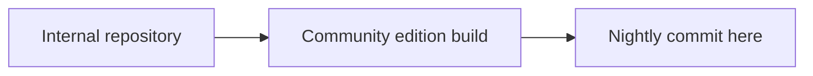

<p align="center">
  <picture>
    <source media="(prefers-color-scheme: dark)" srcset=".github/assets/intro-dark.gif">
    <source media="(prefers-color-scheme: light)" srcset=".github/assets/intro-light.gif">
    
  </picture>
</p>

<h1 align="center">Bryntum</h1>

<p align="center">
  Scheduler, Gantt, Grid, Calendar and Kanban Task Board UI components for JavaScript and TypeScript.<br>
  Works with React, Angular, Vue or plain JS. The Community edition is free and MIT licensed.
</p>

<p align="center">
  <a href="https://www.npmjs.com/package/@bryntum/grid-community"></a>
  <a href="#community-business-and-enterprise"></a>
  
  <a href="https://github.com/bryntum/bryntum"></a>
  <br>
  
  
  
  
  <a href="https://forum.bryntum.com"></a>
</p>

<p align="center">
  <a href="https://bryntum.com/examples/"></a>
  <a href="https://bryntum.com/docs/"></a>
</p>

<p align="center">
  <b><a href="#products">Products</a></b> ·
  <b><a href="#quick-start">Quick start</a></b> ·
  <b><a href="#why-bryntum">Why Bryntum</a></b> ·
  <b><a href="#community-business-and-enterprise">Editions</a></b> ·
  <b><a href="#about-this-repository">This repository</a></b> ·
  <b><a href="#support-and-community">Support</a></b>
</p>

## Introduction

[Bryntum](https://bryntum.com) builds high-performance UI components for scheduling, planning and data-heavy
web applications. They are written in plain JavaScript and CSS with no framework dependency, and come with
wrappers for React, Angular and Vue. All products share one data layer, one theming system and one API style, so
once you know one you know the rest.

This repository holds the **free, open-source Community edition** and the **issue tracker** for all Bryntum products.

## Products

<p align="center">
  <a href="https://bryntum.com/products/scheduler/"><picture><source media="(prefers-color-scheme: dark)" srcset=".github/assets/card-scheduler-dark.png"><source media="(prefers-color-scheme: light)" srcset=".github/assets/card-scheduler-light.png"></picture></a>
  <a href="https://bryntum.com/products/gantt/"><picture><source media="(prefers-color-scheme: dark)" srcset=".github/assets/card-gantt-dark.png"><source media="(prefers-color-scheme: light)" srcset=".github/assets/card-gantt-light.png"></picture></a>
</p>
<p align="center">
  <a href="https://bryntum.com/products/calendar/"><picture><source media="(prefers-color-scheme: dark)" srcset=".github/assets/card-calendar-dark.png"><source media="(prefers-color-scheme: light)" srcset=".github/assets/card-calendar-light.png"></picture></a>
  <a href="https://bryntum.com/products/taskboard/"><picture><source media="(prefers-color-scheme: dark)" srcset=".github/assets/card-taskboard-dark.png"><source media="(prefers-color-scheme: light)" srcset=".github/assets/card-taskboard-light.png"></picture></a>
  <a href="https://bryntum.com/products/grid/"><picture><source media="(prefers-color-scheme: dark)" srcset=".github/assets/card-grid-dark.png"><source media="(prefers-color-scheme: light)" srcset=".github/assets/card-grid-light.png"></picture></a>
</p>

| Product | What it is for | Examples |
|:--|:--|:-:|
| **Scheduler** | Resource timelines for bookings, shifts and equipment | [Examples](https://bryntum.com/products/scheduler/examples/) |
| **Gantt** | Project plans with dependencies and a scheduling engine | [Examples](https://bryntum.com/products/gantt/examples/) |
| **Calendar** | Day, week, month and agenda views with drag-drop events | [Examples](https://bryntum.com/products/calendar/examples/) |
| **Task Board** | Kanban boards with columns, swimlanes and custom cards | [Examples](https://bryntum.com/products/taskboard/examples/) |
| **Grid** | Virtualized data grid for very large datasets | [Examples](https://bryntum.com/products/grid/examples/) |

## Quick start

Pick a product. Each one installs from npm, with wrappers for React, Angular and Vue.

<details>
<summary><b>Scheduler</b></summary>

```bash
npm install @bryntum/scheduler-community
```

```js
import { Scheduler } from '@bryntum/scheduler-community';

new Scheduler({
    appendTo   : document.body,
    startDate  : new Date(2026, 0, 1),
    endDate    : new Date(2026, 0, 8),
    viewPreset : 'dayAndWeek',
    columns    : [{ field : 'name', text : 'Name', width : 160 }],
    resources  : [{ id : 1, name : 'Ada' }, { id : 2, name : 'Linus' }],
    events     : [{ id : 1, resourceId : 1, name : 'Review', startDate : '2026-01-02', endDate : '2026-01-04' }]
});
```

</details>

<details>
<summary><b>Gantt</b></summary>

```bash
npm install @bryntum/gantt-community
```

```js
import { Gantt } from '@bryntum/gantt-community';

new Gantt({
    appendTo  : document.body,
    startDate : new Date(2026, 0, 1),
    endDate   : new Date(2026, 1, 1),
    columns   : [{ type : 'name', width : 200 }],
    project   : {
        tasks : [
            { id : 1, name : 'Design', startDate : '2026-01-02', duration : 5 },
            { id : 2, name : 'Build',  startDate : '2026-01-09', duration : 10 }
        ],
        dependencies : [{ fromTask : 1, toTask : 2 }]
    }
});
```

</details>

<details>
<summary><b>Calendar</b></summary>

```bash
npm install @bryntum/calendar-community
```

```js
import { Calendar } from '@bryntum/calendar-community';

new Calendar({
    appendTo : document.body,
    date     : new Date(2026, 0, 5),
    resources : [{ id : 1, name : 'Ada', eventColor : 'blue' }],
    events    : [{ id : 1, resourceId : 1, name : 'Standup', startDate : '2026-01-05T09:00', endDate : '2026-01-05T09:30' }]
});
```

</details>

<details>
<summary><b>Task Board</b></summary>

```bash
npm install @bryntum/taskboard-community
```

```js
import { TaskBoard } from '@bryntum/taskboard-community';

new TaskBoard({
    appendTo    : document.body,
    columnField : 'status',
    columns     : ['todo', 'doing', 'done'],
    project     : {
        tasks : [
            { id : 1, name : 'Write docs', status : 'todo' },
            { id : 2, name : 'Fix bug',    status : 'doing' }
        ]
    }
});
```

</details>

<details>
<summary><b>Grid</b></summary>

```bash
npm install @bryntum/grid-community
```

```js
import { Grid } from '@bryntum/grid-community';

new Grid({
    appendTo : document.body,
    columns  : [
        { field : 'name', text : 'Name', flex : 1 },
        { field : 'city', text : 'City', flex : 1 }
    ],
    data : [
        { id : 1, name : 'Ada',   city : 'London' },
        { id : 2, name : 'Linus', city : 'Helsinki' }
    ]
});
```

</details>

<details>
<summary><b>All npm packages</b></summary>

| Product | Core package | Framework wrappers |
|---|---|---|
| Scheduler | `@bryntum/scheduler-community` | `@bryntum/scheduler-react-community`, `-angular-community`, `-vue-community` |
| Gantt | `@bryntum/gantt-community` | `@bryntum/gantt-react-community`, `-angular-community`, `-vue-community` |
| Calendar | `@bryntum/calendar-community` | `@bryntum/calendar-react-community`, `-angular-community`, `-vue-community` |
| Task Board | `@bryntum/taskboard-community` | `@bryntum/taskboard-react-community`, `-angular-community`, `-vue-community` |
| Grid | `@bryntum/grid-community` | `@bryntum/grid-react-community`, `-angular-community`, `-vue-community` |

Naming: `@bryntum/<product>-<tier>` for the core and `@bryntum/<product>-<wrapper>-<tier>` for wrappers. The Business and Enterprise
editions use `business` and `enterprise` as the tier.

</details>

## Why Bryntum

| Strength | What it means |
|:--|:--|
| ⚡ **Fast with big data** | Virtualized rendering keeps scrolling smooth with very large datasets. |
| 🧩 **Plain JavaScript core** | No framework lock-in. Wrappers for React, Angular and Vue. |
| 🎨 **Themeable** | Several themes including dark mode, customizable with CSS variables. |
| 🟦 **TypeScript** | Typings included. |
| ♿ **Accessible and localized** | Keyboard navigation, ARIA support and many locales. |
| 🔌 **Bring your own backend** | Load and sync data over REST, or use any data source you like. |

### Themes

Built-in themes, including light and dark, that you can switch at runtime and customize with CSS variables.

<p align="center">
  
</p>

## Community, Business and Enterprise

Every product ships in three editions from one codebase. Each edition includes everything in the one before it.

|  | Community | Business | Enterprise |
|:--|:-:|:-:|:-:|
| **Price** | Free | Paid | Paid |
| **License** | MIT | Commercial | Commercial |
| **License key** | Not needed | 14-day trial without one | 14-day trial without one |
| **Salesforce version** | – | – | ✓ |
| **npm package** | `-community` | `-business` | `-enterprise` |

Which features sit in which edition differs per product, see the feature availability guide in the
[docs](https://bryntum.com/docs/). Pricing: [bryntum.com/store](https://bryntum.com/store).

## About this repository

This repository is two things:

* **The source of the Bryntum Community edition**, under the MIT license
* **The issue tracker** for all Bryntum products

The code here is a copy of the Community edition, built every night from Bryntum's internal repository.



### Repository layout

```text
bryntum/
├── lib/                     Source of each product as ES modules (lib/Core, lib/Grid, ...)
├── tsconfig.json            Compiles the scheduling engine, see below
└── LICENSE                  MIT
```

### Compiling Engine

Scheduler, Gantt, Calendar and Kanban Task Board build on the scheduling engine in `lib/Engine`. It is written in
TypeScript, like the part of ChronoGraph it uses in `lib/ChronoGraph`, and needs compiling to JavaScript before those
products run from `lib/`. Grid does not need it. The `tsconfig.json` in the repository root compiles it, with
TypeScript 3.8, newer versions report type errors:

```bash
npx -p typescript@3.8 tsc
```

The compiled modules are written next to their sources.

## Reporting issues

Found a bug or have a feature request? Search the [existing issues](https://github.com/bryntum/bryntum/issues)
first, then open a new one from the templates. For bugs, reproduce the problem in one of our
[online demos](https://bryntum.com/examples) or include a small test case. Reports with clear steps get fixed sooner.

For questions and help, visit the [Bryntum Forum](https://forum.bryntum.com/).

## Contributing

This repository is a nightly copy, pull requests cannot be merged here directly. If you have a fix, open an issue
describing it, with a link to your branch or a patch.

## Support and community

| Need | Where to go |
|:--|:--|
| 💬 **Questions and help** | [Bryntum Forum](https://forum.bryntum.com/) |
| 🐛 **Bugs and feature requests** | [GitHub issues](https://github.com/bryntum/bryntum/issues) |
| 📚 **Documentation** | [Docs](https://bryntum.com/docs/) |
| 🏢 **Licensing and commercial editions** | [Contact us](https://bryntum.com/contact) |

<p align="center">
  <a href="https://x.com/bryntum"></a>
  <a href="https://www.linkedin.com/company/2193317"></a>
  <a href="https://www.youtube.com/@bryntum"></a>
</p>

### Trusted by

<p align="center">
  <picture>
    <source media="(prefers-color-scheme: dark)" srcset=".github/assets/trusted-by-dark.svg">
    <source media="(prefers-color-scheme: light)" srcset=".github/assets/trusted-by.svg">
    
  </picture>
</p>

If Bryntum is useful to you, a ⭐ on this repository helps others find it.

## License

The Community edition in this repository is released under the [MIT license](./LICENSE).

The Business and Enterprise editions are commercial, see the [Bryntum license terms](https://bryntum.com/licensing/).

<p align="center">
  <sub>© Bryntum AB · <a href="https://bryntum.com">bryntum.com</a></sub>
</p>
