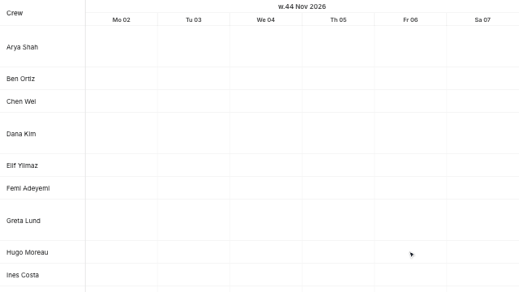
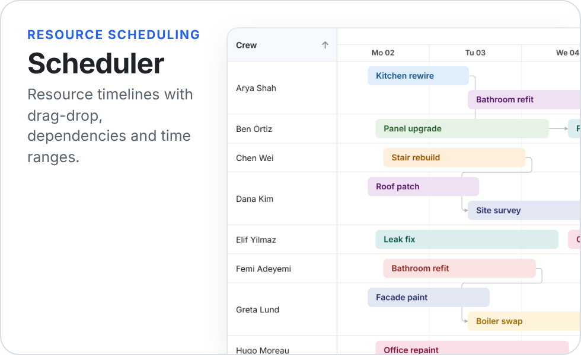
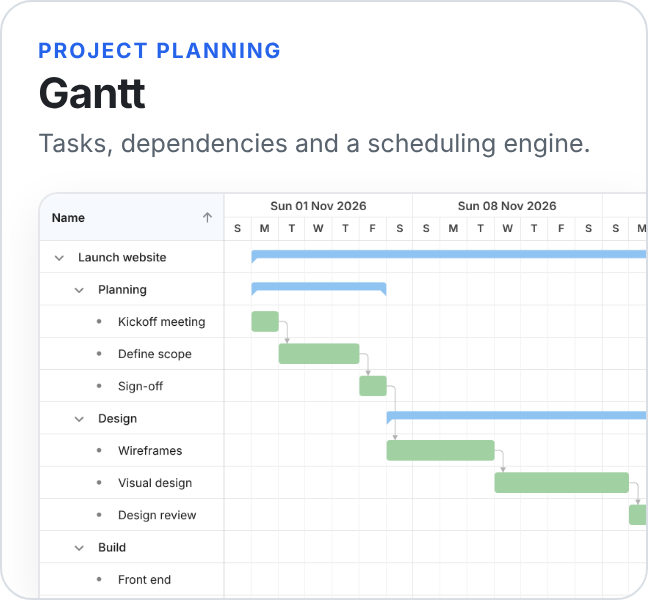
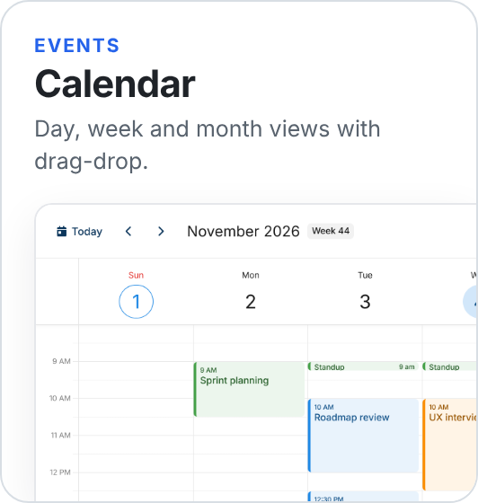
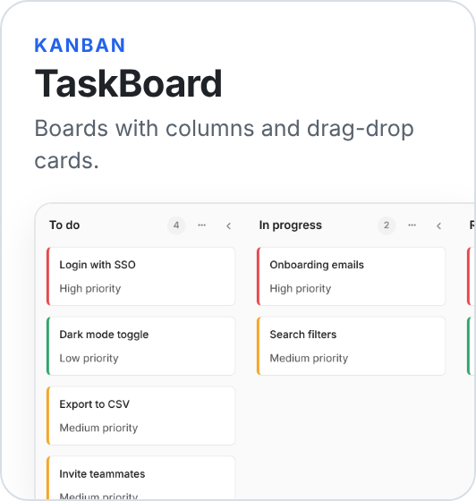
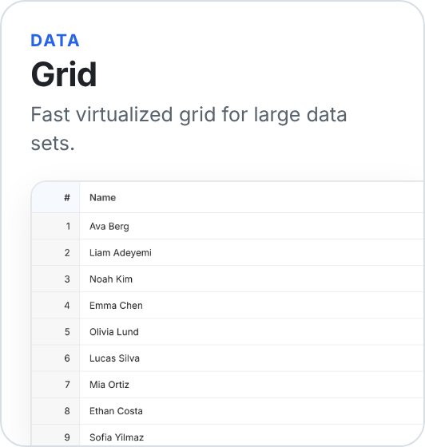
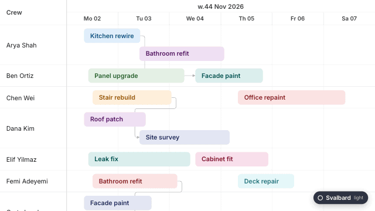
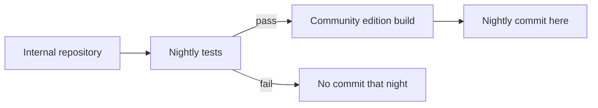

<p align="center">
  <picture>
    <source media="(prefers-color-scheme: dark)" srcset=".github/assets/intro-dark.gif">
    
  </picture>
</p>

<h1 align="center">Bryntum</h1>

<p align="center">
  Scheduler, Gantt, Grid, Calendar and Kanban Task Board UI components for JavaScript and TypeScript.<br>
  Works with React, Angular, Vue or plain JS. The Community edition is free and MIT licensed.
</p>

<p align="center">
  <a href="https://www.npmjs.com/package/@bryntum/grid-community"></a>
  <a href="#community-business-and-enterprise"></a>
  
  <a href="https://github.com/bryntum/bryntum"></a>
  <br>
  
  
  
  
  <a href="https://forum.bryntum.com"></a>
</p>

<p align="center">
  <a href="https://bryntum.com/examples/"></a>
  <a href="https://bryntum.com/docs/"></a>
</p>

<p align="center">
  <b><a href="#products">Products</a></b> ·
  <b><a href="#quick-start">Quick start</a></b> ·
  <b><a href="#why-bryntum">Why Bryntum</a></b> ·
  <b><a href="#community-business-and-enterprise">Editions</a></b> ·
  <b><a href="#about-this-repository">This repository</a></b> ·
  <b><a href="#running-the-examples">Run the examples</a></b> ·
  <b><a href="#support-and-community">Support</a></b>
</p>

## Introduction

[Bryntum](https://bryntum.com) builds high-performance UI components for scheduling, planning and data-heavy
web applications. They are written in plain JavaScript and CSS with no framework dependency, and come with
wrappers for React, Angular and Vue. All products share one data layer, one theming system and one API style, so
once you know one you know the rest.

This repository holds the **free, open-source Community edition** and the **issue tracker** for all Bryntum products.

## Products

<p align="center">
  <a href="https://bryntum.com/products/scheduler/docs/"><picture><source media="(prefers-color-scheme: dark)" srcset=".github/assets/card-scheduler-dark.png"></picture></a>
  <a href="https://bryntum.com/products/gantt/docs/"><picture><source media="(prefers-color-scheme: dark)" srcset=".github/assets/card-gantt-dark.png"></picture></a>
</p>
<p align="center">
  <a href="https://bryntum.com/products/calendar/docs/"><picture><source media="(prefers-color-scheme: dark)" srcset=".github/assets/card-calendar-dark.png"></picture></a>
  <a href="https://bryntum.com/products/taskboard/docs/"><picture><source media="(prefers-color-scheme: dark)" srcset=".github/assets/card-taskboard-dark.png"></picture></a>
  <a href="https://bryntum.com/products/grid/docs/"><picture><source media="(prefers-color-scheme: dark)" srcset=".github/assets/card-grid-dark.png"></picture></a>
</p>

| Product | What it is for | Examples | Docs |
|:--|:--|:-:|:-:|
| **Scheduler** | Resource timelines for bookings, shifts and equipment | [Examples](https://bryntum.com/products/scheduler/examples/) | [Docs](https://bryntum.com/docs/) |
| **Gantt** | Project plans with dependencies and a scheduling engine | [Examples](https://bryntum.com/products/gantt/examples/) | [Docs](https://bryntum.com/docs/) |
| **Calendar** | Day, week, month and agenda views with drag-drop events | [Examples](https://bryntum.com/products/calendar/examples/) | [Docs](https://bryntum.com/docs/) |
| **Task Board** | Kanban boards with columns, swimlanes and custom cards | [Examples](https://bryntum.com/products/taskboard/examples/) | [Docs](https://bryntum.com/docs/) |
| **Grid** | Virtualized data grid for very large datasets | [Examples](https://bryntum.com/products/grid/examples/) | [Docs](https://bryntum.com/docs/) |

## Quick start

Pick a product. Each one installs from npm and has a framework demo for React, Angular and Vue.

<details>
<summary><b>Scheduler</b></summary>

```bash
npm install @bryntum/scheduler-community
```

```js
import { Scheduler } from '@bryntum/scheduler-community';

new Scheduler({
    appendTo   : document.body,
    startDate  : new Date(2026, 0, 1),
    endDate    : new Date(2026, 0, 8),
    viewPreset : 'dayAndWeek',
    columns    : [{ field : 'name', text : 'Name', width : 160 }],
    resources  : [{ id : 1, name : 'Ada' }, { id : 2, name : 'Linus' }],
    events     : [{ id : 1, resourceId : 1, name : 'Review', startDate : '2026-01-02', endDate : '2026-01-04' }]
});
```

Framework demos: [`examples-scheduler/frameworks/`](./examples-scheduler/frameworks)

</details>

<details>
<summary><b>Gantt</b></summary>

```bash
npm install @bryntum/gantt-community
```

```js
import { Gantt } from '@bryntum/gantt-community';

new Gantt({
    appendTo  : document.body,
    startDate : new Date(2026, 0, 1),
    endDate   : new Date(2026, 1, 1),
    columns   : [{ type : 'name', width : 200 }],
    project   : {
        tasks : [
            { id : 1, name : 'Design', startDate : '2026-01-02', duration : 5 },
            { id : 2, name : 'Build',  startDate : '2026-01-09', duration : 10 }
        ],
        dependencies : [{ fromTask : 1, toTask : 2 }]
    }
});
```

Framework demos: [`examples-gantt/frameworks/`](./examples-gantt/frameworks)

</details>

<details>
<summary><b>Calendar</b></summary>

```bash
npm install @bryntum/calendar-community
```

```js
import { Calendar } from '@bryntum/calendar-community';

new Calendar({
    appendTo : document.body,
    date     : new Date(2026, 0, 5),
    resources : [{ id : 1, name : 'Ada', eventColor : 'blue' }],
    events    : [{ id : 1, resourceId : 1, name : 'Standup', startDate : '2026-01-05T09:00', endDate : '2026-01-05T09:30' }]
});
```

Framework demos: [`examples-calendar/frameworks/`](./examples-calendar/frameworks)

</details>

<details>
<summary><b>Task Board</b></summary>

```bash
npm install @bryntum/taskboard-community
```

```js
import { TaskBoard } from '@bryntum/taskboard-community';

new TaskBoard({
    appendTo    : document.body,
    columnField : 'status',
    columns     : ['todo', 'doing', 'done'],
    project     : {
        tasks : [
            { id : 1, name : 'Write docs', status : 'todo' },
            { id : 2, name : 'Fix bug',    status : 'doing' }
        ]
    }
});
```

Framework demos: [`examples-taskboard/frameworks/`](./examples-taskboard/frameworks)

</details>

<details>
<summary><b>Grid</b></summary>

```bash
npm install @bryntum/grid-community
```

```js
import { Grid } from '@bryntum/grid-community';

new Grid({
    appendTo : document.body,
    columns  : [
        { field : 'name', text : 'Name', flex : 1 },
        { field : 'city', text : 'City', flex : 1 }
    ],
    data : [
        { id : 1, name : 'Ada',   city : 'London' },
        { id : 2, name : 'Linus', city : 'Helsinki' }
    ]
});
```

Framework demos: [`examples-grid/frameworks/`](./examples-grid/frameworks)

</details>

<details>
<summary><b>All npm packages</b></summary>

| Product | Core package | Framework wrappers |
|---|---|---|
| Scheduler | `@bryntum/scheduler-community` | `@bryntum/scheduler-react-community`, `-angular-community`, `-vue-community` |
| Gantt | `@bryntum/gantt-community` | `@bryntum/gantt-react-community`, `-angular-community`, `-vue-community` |
| Calendar | `@bryntum/calendar-community` | `@bryntum/calendar-react-community`, `-angular-community`, `-vue-community` |
| Task Board | `@bryntum/taskboard-community` | `@bryntum/taskboard-react-community`, `-angular-community`, `-vue-community` |
| Grid | `@bryntum/grid-community` | `@bryntum/grid-react-community`, `-angular-community`, `-vue-community` |

Naming: `@bryntum/<product>-<tier>` for the core and `@bryntum/<product>-<wrapper>-<tier>` for wrappers. The Business and Enterprise
editions use `business` and `enterprise` as the tier.

</details>

## Why Bryntum

<!-- TODO(content): confirm these claims with product/marketing before publishing. -->

| Strength | What it means |
|:--|:--|
| ⚡ **Fast with big data** | Virtualized rendering keeps scrolling smooth with very large datasets. |
| 🧩 **Plain JavaScript core** | No framework lock-in. Wrappers for React, Angular and Vue. |
| 🎨 **Themeable** | Several themes including dark mode, customizable with CSS variables. |
| 🟦 **TypeScript** | Typings included. |
| ♿ **Accessible and localized** | Keyboard navigation, ARIA support and many locales. |
| 🔌 **Bring your own backend** | Load and sync data over REST, or use any data source you like. |

### Themes

Built-in themes, including light and dark, that you can switch at runtime and customize with CSS variables.

<p align="center">
  
</p>

## Community, Business and Enterprise

Every product ships in three editions from one codebase. Each edition includes everything in the one before it.

|  | Community | Business | Enterprise |
|:--|:-:|:-:|:-:|
| **Price** | Free | Paid | Paid |
| **License** | MIT | Commercial | Commercial |
| **License key** | Not needed | 14-day trial without one | 14-day trial without one |
| **Salesforce version** | – | – | ✓ |
| **npm package** | `-community` | `-business` | `-enterprise` |

<!-- Package names are shown as suffixes. Full form: @bryntum/<product>-<edition> -->

Which features sit in which edition differs per product, see the feature availability guide in the
[docs](https://bryntum.com/docs/). Pricing: [bryntum.com/store](https://bryntum.com/store).

## About this repository

This repository is two things:

* **The source of the Bryntum Community edition**, under the MIT license
* **The issue tracker** for all Bryntum products

The code is a copy of Bryntum's internal repository, published every night **after the nightly test run passes**.
Each nightly commit lists the changes merged that day.



### Repository layout

```text
bryntum/
├── lib/                     Source of each product, as ES modules (lib/Core, lib/Grid, ...)
├── build/                   Compiled theme CSS and Font Awesome, used by the examples
├── resources/               Fonts and icons
├── examples-scheduler/      Scheduler demos
├── examples-gantt/          Gantt demos
├── examples-calendar/       Calendar demos
├── examples-grid/           Grid demos
├── examples-taskboard/      Task Board demos
│   └── frameworks/          React, Angular and Vue demos (in each examples-* folder)
└── LICENSE                  MIT
```

## Running the examples

The plain JavaScript demos load the sources from `lib/` directly, so there is **no build step**.

**1. Serve the repository root with any static web server**

```bash
npx http-server -c-1 .
```

**2. Open a product's demos**

```text
http://localhost:8080/examples-grid/
```

Other products follow the same pattern: `examples-scheduler/`, `examples-gantt/`, `examples-calendar/` and `examples-taskboard/`.

Prefer not to run anything? The same demos are hosted online:
[Scheduler](https://bryntum.com/products/scheduler/examples/) ·
[Gantt](https://bryntum.com/products/gantt/examples/) ·
[Calendar](https://bryntum.com/products/calendar/examples/) ·
[Task Board](https://bryntum.com/products/taskboard/examples/) ·
[Grid](https://bryntum.com/products/grid/examples/)

> [!IMPORTANT]
> Opening the HTML files straight from disk does not work. Browsers block ES module imports over `file://`.

### Framework demos

The React, Angular and Vue demos live in `examples-*/frameworks/`. They install the Community packages from npm:

```bash
cd examples-grid/frameworks/react-vite/basic
npm install
npm run dev
```

| Demo type | Where the code comes from |
|:--|:--|
| Plain JavaScript | **Nightly** sources in `lib/` |
| React, Angular, Vue | Latest **published** npm packages |

> [!NOTE]
> Because of this, the plain JavaScript demos and the framework demos can differ slightly between releases.

## Reporting issues

Found a bug or have a feature request? Search the [existing issues](https://github.com/bryntum/bryntum/issues)
first, then open a new one using the templates. For bugs, please reproduce the problem in one of our
[online demos](https://bryntum.com/examples/) or include a small test case. Reports with clear steps get fixed sooner.

## Contributing

This repository is a nightly copy, so pull requests cannot be merged here directly yet. If you have a fix, open
an issue describing it, and include a link to your branch or a patch.

## Support and community

| Need | Where to go |
|:--|:--|
| 💬 **Questions and help** | [Bryntum Forum](https://forum.bryntum.com/) |
| 🐛 **Bugs and feature requests** | [GitHub issues](https://github.com/bryntum/bryntum/issues) |
| 📚 **Documentation** | [Docs](https://bryntum.com/docs/) |
| 🏢 **Licensing and commercial editions** | [Contact us](https://bryntum.com/contact) |

<!-- TODO(optional): social links (X, LinkedIn, YouTube). -->

### Trusted by

<p align="center">
  <picture><source media="(prefers-color-scheme: dark)" srcset=".github/assets/logos/apple-dark.svg"></picture>
  <picture><source media="(prefers-color-scheme: dark)" srcset=".github/assets/logos/bmw-dark.svg"></picture>
  <picture><source media="(prefers-color-scheme: dark)" srcset=".github/assets/logos/intel-dark.svg"></picture>
  <picture><source media="(prefers-color-scheme: dark)" srcset=".github/assets/logos/netflix-dark.svg"></picture>
  <picture><source media="(prefers-color-scheme: dark)" srcset=".github/assets/logos/samsung-dark.svg"></picture>
</p>

If Bryntum is useful to you, a ⭐ on this repository helps others find it.

## License

The Community edition in this repository is released under the [MIT license](./LICENSE).
The Business and Enterprise editions are commercial products, see the
[Bryntum license terms](https://bryntum.com/licensing/).

<p align="center">
  <sub>© Bryntum AB · <a href="https://bryntum.com">bryntum.com</a></sub>
</p>
